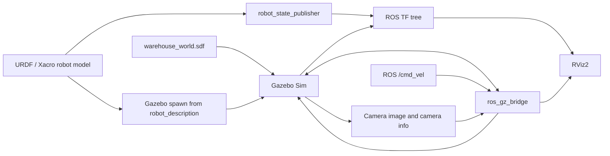

# ROS 2 Mobile Robot Simulation — Gazebo Warehouse

A work-in-progress ROS 2 mobile robot simulation built with **URDF/Xacro**, **Gazebo Sim**, **RViz2**, and **`ros_gz`**. This repository contains the car base before a manipulator arm or autonomy stack is added.

> **Project status:** Early-stage / under development. The robot model, camera sensor, warehouse world, launch files, and bridge configuration are included. In the source snapshot used to prepare this repository, `/joint_states` did not return a message in the author's environment, so dynamic wheel TFs still need to be validated end-to-end. See [Known limitations](#known-limitations--next-steps) before treating the simulation as complete.

## Features

- Differential-drive mobile base with left and right driven wheel joints, plus a fixed caster wheel.
- Modular Xacro files for the base, camera, Gazebo plugins, materials, and inertia helpers.
- Simulated front-mounted camera configured for 1280 × 720 images at 20 Hz.
- Custom warehouse-style Gazebo world with boundaries, internal walls, obstacles, and shelf blocks.
- ROS–Gazebo bridge configuration for velocity commands, simulation clock, joint state, TF, and camera topics.
- RViz configuration for viewing the robot model and TF tree.

## Repository layout

```text
ros2-gazebo-mobile-robot/
├── my_robot_description/
│   ├── urdf/
│   │   ├── my_robot.urdf.xacro
│   │   ├── mobile_base.xacro
│   │   ├── mobile_base_gazebo.xacro
│   │   ├── camera.xacro
│   │   └── common_properties.xacro
│   ├── launch/
│   │   └── display.launch.xml
│   ├── rviz/
│   │   └── default_my_robot_config.rviz
│   ├── CMakeLists.txt
│   └── package.xml
├── my_robot_bringup/
│   ├── launch/
│   │   └── my_robot_gazebo.launch.xml
│   ├── config/
│   │   └── gazebo_bridge.yaml
│   ├── worlds/
│   │   └── warehouse_world.sdf
│   ├── CMakeLists.txt
│   └── package.xml
├── docs/
├── .gitignore
├── LICENSE
└── README.md
```

## Robot model

| Property | Current configuration |
|---|---|
| Robot model name | `my_robot` |
| Base body | Box, 0.60 m × 0.40 m × 0.20 m |
| Driven wheels | Two continuous joints: `base_left_wheel_joint`, `base_right_wheel_joint` |
| Wheel radius | 0.10 m |
| Wheel width | 0.05 m |
| Caster | Fixed spherical caster, 0.05 m radius |
| Camera image | 1280 × 720, RGB (`R8G8B8`) |
| Camera update rate | 20 Hz |
| Camera horizontal field of view | About 80° |
| Main base frames | `base_footprint` → `base_link` |
| Simulation world | `warehouse_world` |

The camera is represented by `camera_link`, with `camera_link_optical` as its optical frame. The model uses simple geometric visuals and collision shapes rather than a detailed mesh model.

## Software target

- **ROS 2:** Lyrical Luth (`lyrical`)
- **Gazebo Sim:** Jetty (the recommended pairing for ROS 2 Lyrical)
- **Build system:** `ament_cmake` and `colcon`

Other ROS 2/Gazebo combinations may work, but are not verified by this repository. See the official [ROS 2 Lyrical release documentation](https://docs.ros.org/en/rolling/Releases/Release-Lyrical-Luth.html) and [Gazebo's ROS integration compatibility table](https://gazebosim.org/docs/latest/ros_installation/).

## Dependencies

Install ROS 2 and its matching Gazebo integration first. On a ROS 2 Lyrical system, the relevant packages can be installed with:

```bash
sudo apt update
sudo apt install \
  ros-lyrical-ros-gz \
  ros-lyrical-xacro \
  ros-lyrical-robot-state-publisher \
  ros-lyrical-joint-state-publisher-gui \
  ros-lyrical-rviz2 \
  python3-colcon-common-extensions \
  python3-rosdep
```

If `rosdep` has not been initialized on your machine, follow the official ROS installation instructions for your platform before running the workspace dependency step.

## Build

Clone this repository into the `src` folder of a ROS 2 workspace. Replace `YOUR_GITHUB_USERNAME` with your GitHub username and change `~/ros2_ws` if your workspace has a different name.

```bash
mkdir -p ~/ros2_ws/src
cd ~/ros2_ws/src
git clone https://github.com/YOUR_GITHUB_USERNAME/ros2-gazebo-mobile-robot.git

cd ~/ros2_ws
source /opt/ros/lyrical/setup.bash
rosdep install --from-paths src --ignore-src -r -y
colcon build --symlink-install
source install/setup.bash
```

For subsequent terminals, source both the ROS underlay and your workspace overlay:

```bash
source /opt/ros/lyrical/setup.bash
source ~/ros2_ws/install/setup.bash
```

## Run the robot

### 1. View the robot in RViz2

This starts `robot_state_publisher`, the joint state publisher GUI, and RViz2.

```bash
ros2 launch my_robot_description display.launch.xml
```

### 2. Launch Gazebo and the warehouse world

This starts Gazebo, spawns the robot from `robot_description`, starts the ROS–Gazebo bridge, and opens RViz2 with the saved configuration.

```bash
ros2 launch my_robot_bringup my_robot_gazebo.launch.xml
```

The world includes an external Sun model from Gazebo Fuel, so an internet connection may be required the first time it is loaded.

## Drive the robot

With the Gazebo launch running, open a second terminal and source the workspace. Publish a forward velocity command:

```bash
ros2 topic pub --rate 10 /cmd_vel geometry_msgs/msg/Twist \
  "{linear: {x: 0.2, y: 0.0, z: 0.0}, angular: {x: 0.0, y: 0.0, z: 0.0}}"
```

Stop the publisher with `Ctrl+C`. The command goes through the bridge to Gazebo's differential-drive system.

## Main ROS topics

These are the topics configured by the launch and bridge files. Verify their actual availability at runtime; a configured bridge does not by itself guarantee that the Gazebo source topic is publishing.

| ROS topic | Type | Intended role |
|---|---|---|
| `/cmd_vel` | `geometry_msgs/msg/Twist` | Velocity commands from ROS to Gazebo |
| `/clock` | `rosgraph_msgs/msg/Clock` | Simulation time from Gazebo to ROS |
| `/joint_states` | `sensor_msgs/msg/JointState` | Wheel joint positions and velocities from Gazebo |
| `/tf` | `tf2_msgs/msg/TFMessage` | Transform data from Gazebo; `robot_state_publisher` also publishes robot link transforms |
| `/camera/image_raw` | `sensor_msgs/msg/Image` | Simulated camera image |
| `/camera/camera_info` | `sensor_msgs/msg/CameraInfo` | Camera calibration metadata |

Useful checks:

```bash
ros2 topic list | grep -E 'clock|joint_states|tf|cmd_vel|camera'
ros2 topic echo /joint_states --once
ros2 topic echo /camera/camera_info --once
```

If `/joint_states` produces no output, check the Gazebo source topic first, before assuming RViz is the cause:

```bash
gz topic -l | grep joint_state
```

Then inspect the exact joint-state topic shown by that command with `gz topic -e -t <topic-name>`. If Gazebo is publishing but ROS is not, check the `gz_topic_name`, message types, and bridge logs in `my_robot_bringup/config/gazebo_bridge.yaml`.

## System overview



## Known limitations & next steps

1. **Joint states / wheel TFs need verification.** The archived version did not produce output from `ros2 topic echo /joint_states --once` in the development environment. Until this is resolved, the left and right wheel transforms may be missing in RViz2.
2. **Simple wheel collision geometry.** The wheels are rendered as cylinders but collide as spheres. This is a simplification and may reduce physical realism; changing the collision geometry to a cylinder or an appropriate tire shape is a reasonable next improvement.
3. **No ROS odometry topic is bridged yet.** The current bridge file does not explicitly map Gazebo odometry to a ROS `/odom` topic.
4. **No autonomy or manipulator arm in this snapshot.** The repository is currently the base car and camera simulation; navigation, perception, and a robot arm are future extensions.
5. **End-to-end runtime testing remains necessary.** XML files parse, but a full ROS/Gazebo build and launch should be tested on the target machine before calling the project complete.

## License

This project is licensed under the MIT License. See [LICENSE](LICENSE). Keep this license only if you are comfortable allowing others to use, modify, and redistribute the project under its terms.
